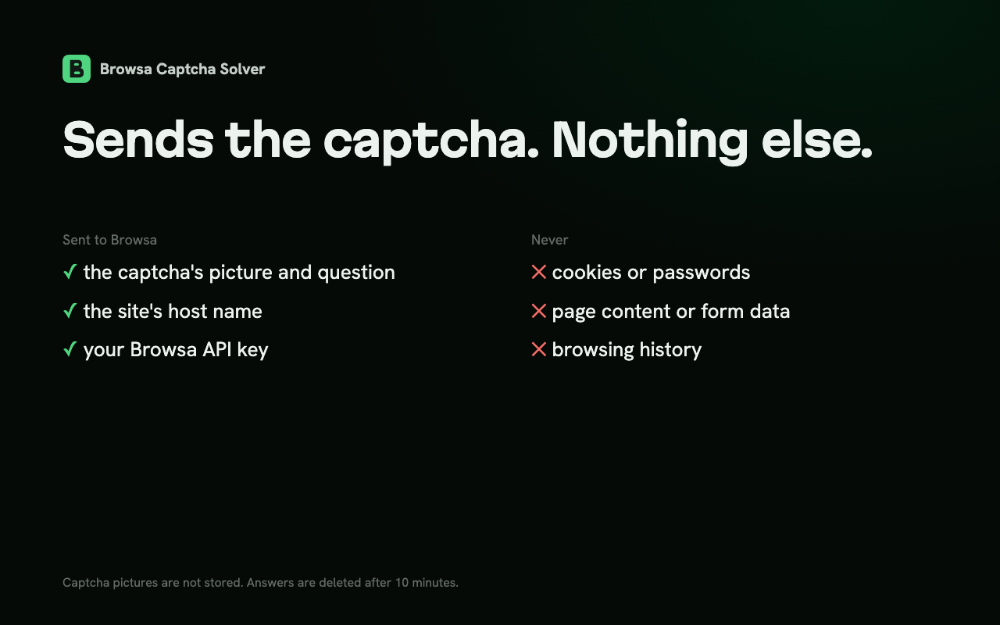

# Browsa Captcha Solver

A browser extension that solves the captcha in front of you with human-like input, using your Browsa API key.

[](https://github.com/browsa-io/captcha-solver/actions/workflows/ci.yml)
[](LICENSE)

This repository is the extension's full source (Manifest V3, Chrome and Firefox from one codebase). The solving
service it calls, Browsa's captcha API, is not part of it.

## Install

- **Chrome** (also Brave, Edge and Opera):
  [Chrome Web Store](https://chromewebstore.google.com/detail/browsa-captcha-solver/plmcdhefocmbmnoccgoghbnidepemhdk)
- **Firefox**: pending Mozilla review. It will be at
  [addons.mozilla.org/firefox/addon/browsa-captcha-solver](https://addons.mozilla.org/firefox/addon/browsa-captcha-solver/)
  once approved. Until then you can [build it from source](#build-from-source).

## Get a key

1. Sign up at [app.browsa.io/signup](https://app.browsa.io/signup). A new account gets 25 free solves to try it.
2. In the dashboard, open **API keys** and create a key.
3. Click the extension's icon, paste the key, **Save**.

Each solve uses Browsa credits. Failed solves are free.

## What it solves today

| Type | Measured on | Passed | Median, page load to pass |
|---|---|---|---|
| reCAPTCHA v2 (checkbox and invisible) | Google's reCAPTCHA v2 demo page (checkbox) | 3 of 3 | 17.3 s |
| GeeTest v3 slide | a public GeeTest v3 demo page | 3 of 3 | 12.0 s |
| GeeTest v4 slide | a public GeeTest v4 demo page | 3 of 3 | 15.7 s |
| Image text ("type the characters") | a public image-text captcha demo page | 3 of 3 | 9.7 s |
| AWS WAF captcha | a public page behind the AWS WAF captcha | 3 of 3 | 28.1 s |

Measured on 2026-11-21 with the 0.1.1 store package, in Chrome for
Testing on a home connection: a fresh profile per attempt, one browser at a time, and a new challenge on every page
load. The reCAPTCHA attempts and two of the GeeTest v3 attempts ran in a visible window, the rest headless.

**A pass counts only when the site's own server accepts the answer**: the demo page's server verdict after its
submit button, or for AWS WAF, the WAF token is set and the page behind the captcha loads. Ticking a box or
dragging a slider is not counted.

Read these numbers for what they are:

- Three attempts per type is a small sample. An earlier run the same day on the same build also passed 3 of 3 for
  each type (medians 4.0 s, 10.8 s, 15.8 s, 9.8 s and 15.9 s in the order above).
- A home connection with a fresh profile is a friendly case for reCAPTCHA. From a data-centre address, or in a
  browser Google distrusts, it asks for more picture rounds.
- Firefox 160, the Firefox package, same pages, headless: reCAPTCHA 3 of 3, GeeTest v3 3 of 3, GeeTest v4 2 of 3,
  image text 3 of 3. AWS WAF showed no captcha to Firefox, so there was nothing to measure.

### Coming next

hCaptcha, Cloudflare Turnstile and other types. Some of their code is already in `src/content/`. It ships switched
off and unlisted until it passes on public pages under the same rule.

## How it works


- **A content script in every frame.** It runs in each page and frame (`all_frames`), finds a supported captcha,
  and starts the one watcher that frame needs. On pages without a supported captcha it does nothing.
- **Provider checks before anything is spent.** reCAPTCHA, hCaptcha and DataDome are solved automatically only
  when the widget's frame comes from the provider's own address. GeeTest and AWS WAF are solved automatically only
  when the page loaded the provider's own scripts. Class names alone never count.
- **Human-like input.** Pointer paths follow a curved, minimum-jerk track with Fitts's-law timing, small tremor and
  overshoot. Slider drags start fast and settle. Typed answers go key by key with natural gaps
  ([`src/lib/human.ts`](src/lib/human.ts)). By default these are DOM pointer, mouse and key events in the captcha's
  own frame. With **Trusted input** (Chrome only, off by default), the same gestures go through Chrome's debugger
  interface as real input, and Chrome shows a bar while it is attached.
- **No remote code.** Everything that runs is in the package. The API returns only answers: tile numbers, text,
  or a slide distance.

### What is sent, and when

This matches [PRIVACY.md](PRIVACY.md), which is the policy.

The extension talks to one service, Browsa's captcha API (`https://captcha.browsa.io` unless you change the server
under Advanced), and only in these cases:

- **Solving a captcha**, after a solve was allowed to start:
  - reCAPTCHA, hCaptcha and DataDome: automatically, when the widget's own frame comes from the provider's address
    (google.com / recaptcha.net, hcaptcha.com, captcha-delivery.com).
  - GeeTest and AWS WAF: automatically, when the page loaded the provider's own scripts (geetest.com, awswaf.com).
  - Picture-text captchas: automatically only on sites where you answered "Solve" to the question the extension
    asks the first time. On any other site, only when you press Solve.
  - Anything, when you press Solve (the panel's button or Alt+Shift+S).
  - At most 3 automatic solves per page load and 10 per site per hour. After an answer was typed, the next picture
    on that page waits 30 s. A picture already solved is never sent again.
- **Checking your key**, when you open the panel and when you change the key: your key only.

A solve sends the captcha's own picture or pictures and its question, the host name of the site (for example
`example.com`, never the full address), and your API key. For hCaptcha, and for any captcha whose picture a page
script cannot read, the picture is a crop of the visible tab limited to the captcha. The rest of the screenshot
never leaves the browser.

It never sends cookies, the page's HTML or text, form contents, passwords, your browsing history, or anything from
pages without a supported captcha. Turnstile, Cloudflare's check page, Altcha and Press & hold are handled in the
page itself, and nothing is sent for them.

Browsa does not store captcha pictures. A solve's answer is deleted after 10 minutes. What is kept, on the
server and in your browser, is listed in [PRIVACY.md](PRIVACY.md#what-is-kept).

It also fetches GeeTest's own puzzle pictures from GeeTest's servers (the same files the page already loaded), and
on install opens `https://browsa.io/extension` in a new tab.



## Permissions

| Permission | Why |
|---|---|
| `storage` | Settings, your key and its last check, the sites you allowed for picture text, and the last 50 solves, on your device. Per-session counters and recently solved answers go in session storage, cleared when the browser closes. |
| Host access `<all_urls>` | Captchas appear on any site and inside the provider's own frames, so the content script must run in those frames. The background uses it to send the captcha to the API, to fetch GeeTest's pictures, and to crop a captcha from the visible tab when a page script cannot read its picture. |
| `debugger` (optional, Chrome) | Requested only when you switch on Trusted input. Sends pointer and key events as real input. Nothing is read through it. |
| `webNavigation` (optional, Chrome) | Requested with Trusted input. Finds where a captcha's frame sits on the page so those events land in the right place. |
| Firefox data collection | Declared for Firefox's install prompt: `authenticationInfo` (your API key) and `websiteContent` (the captcha and the site's host name). |

The keyboard shortcut Alt+Shift+S presses Solve.

## Build from source

You need Node.js 22.18 or later (the tests import TypeScript directly) and, for packaging, `zip` and `unzip`.

```bash
git clone https://github.com/browsa-io/captcha-solver.git
cd captcha-solver
npm ci
npm run typecheck
npm test
npm run build             # dist/chrome
npm run build:firefox     # dist/firefox
```

Load the build:

- **Chrome**: open `chrome://extensions`, switch on Developer mode, click **Load unpacked**, pick `dist/chrome`.
- **Firefox**: open `about:debugging#/runtime/this-firefox`, click **Load Temporary Add-on**, pick
  `dist/firefox/manifest.json`.

`node scripts/build.mjs --api=https://...` changes the API address compiled in as the default. The panel's
Advanced section can also change it.

### Reproducible build

The same source builds the same files. To check a published package against this repository:

```bash
git checkout <commit>         # the commit of the version the store serves (its package.json "version")
npm ci
npm run package               # dist/browsa-captcha-solver-<version>.zip, its sha256, every file's sha256
npm run package:firefox       # dist/browsa-captcha-solver-firefox-<version>.zip, the same

# the package the Chrome Web Store serves
curl -L -o store.crx 'https://clients2.google.com/service/update2/crx?response=redirect&prodversion=131.0&acceptformat=crx2,crx3&x=id%3Dplmcdhefocmbmnoccgoghbnidepemhdk%26uc'
node scripts/hashes.mjs dist/chrome --against=store.crx
```

Compare files, not zip files. A zip also stores file times and order, so the zip's own sha256 only matches a zip
made the same way. `npm run package` fixes both, so its zip is identical on every machine with Info-ZIP's `zip`.
The stores add their own files: a `.crx` carries `_metadata/` and an `update_url` line at the top of
`manifest.json`, and a signed `.xpi` carries `META-INF/`. `scripts/hashes.mjs` leaves those out and says so.

The tree hash, one sha256 over the per-file list, is what `find . -type f | LC_ALL=C sort | xargs sha256sum | sha256sum`
prints in the build folder. Every CI run rebuilds both packages, prints these hashes, uploads the zips as a build
artifact, and compares with the Chrome Web Store package when the store serves the same version.

## Automation (Puppeteer, Playwright, Selenium)

The automation build is an unpacked build that takes its settings from a file, so a fresh profile needs no clicks.
Keep the key in the environment, not in a file:

```bash
cp automation.example.json automation.json    # git-ignored; edit the settings, leave apiKey as is
BROWSA_API_KEY=agt_live_... npm run build:automation                       # dist/automation
BROWSA_API_KEY=agt_live_... npm run build:automation -- --target=firefox   # dist/automation-firefox
```

The key is written only into `dist/automation/automation.json`, which is git-ignored. The settings are applied on
install and on every browser start. Set `"trustedInput": true` to use Trusted input. The automation build has the
`debugger` permission without a prompt. Wait about two seconds after the browser starts before changing settings
yourself, so the install step does not overwrite them.

Branded Google Chrome 137 and later ignores `--load-extension`. Use Chrome for Testing
(`npx @puppeteer/browsers install chrome@stable`, or the browser Playwright installs). Some sites refuse a browser
whose user agent says `HeadlessChrome` before any captcha appears. Set a normal user agent if that happens.

```js
import path from 'node:path';
const ext = path.resolve('dist/automation');

// Playwright
import { chromium } from 'playwright';
const ctx = await chromium.launchPersistentContext('/tmp/profile', {
  headless: false,
  args: ['--headless=new', `--disable-extensions-except=${ext}`, `--load-extension=${ext}`],
});

// Puppeteer
import puppeteer from 'puppeteer';
const browser = await puppeteer.launch({
  headless: false,
  executablePath: chromeForTesting,          // path to Chrome for Testing
  args: ['--headless=new', `--disable-extensions-except=${ext}`, `--load-extension=${ext}`],
});
```

```python
# Selenium
import os
from selenium import webdriver
opts = webdriver.ChromeOptions()
opts.binary_location = CHROME_FOR_TESTING   # path to Chrome for Testing
ext = os.path.abspath("dist/automation")
opts.add_argument("--headless=new")
opts.add_argument(f"--load-extension={ext}")
driver = webdriver.Chrome(options=opts)
```

### Knowing the result

The automation build writes each outcome on the page's top document as `<html data-browsa-captcha="...">` and fires
a `browsa-captcha` event on `document`:

```js
// solving:<type> | solved:<type> | typed:text | failed:<type>:<reason> | skipped:<type>:<reason> | paused:... | unsupported:...
await page.waitForFunction(() => /^(solved|typed|failed|skipped|unsupported)/.test(
  document.documentElement.dataset.browsaCaptcha || ''));
const state = await page.evaluate(() => document.documentElement.dataset.browsaCaptcha);   // e.g. "solved:recaptcha"
// or: document.addEventListener('browsa-captcha', (e) => e.detail /* { state, kind, reason } */)
```

Errors arrive the same way, for example `skipped:text:no_key`, `failed:text:error_key_denied_access` or
`failed:geetest:error_zero_balance`. The store build never writes this signal, because it would tell sites that
the extension is installed.

## Project layout

| Path | What it is |
|---|---|
| `src/content/` | The content script: one module per captcha type, the in-page notice, and `main.ts`, which starts them |
| `src/lib/` | Provider checks (`origin.ts`), what may start a solve (`guard.ts`), motion (`human.ts`), input (`input.ts`), messages (`reasons.ts`) |
| `src/background.ts` | The only network requests: API calls, GeeTest pictures, the tab-capture fallback, the solve log |
| `src/popup/` | The panel |
| `scripts/` | `build.mjs`, `package.mjs` (store zips), `hashes.mjs` (file hashes and comparison) |
| `test/` | Unit tests (`npm test`), no keys or network needed |

## Contributing and security

See [CONTRIBUTING.md](CONTRIBUTING.md). Report security issues privately to support@browsa.io
([SECURITY.md](SECURITY.md)). Changes per version: [CHANGELOG.md](CHANGELOG.md).

## License

[MIT](LICENSE), Copyright (c) 2026 Browsa Technologies LLC. The license covers this code. It does not grant use of
the Browsa name or logo, or access to the Browsa API, which needs an account.

`static/fonts/hanken-grotesk.woff2` is Hanken Grotesk, Copyright 2021 The Hanken Grotesk Project Authors, under the
SIL Open Font License 1.1 (license text in [`static/fonts/OFL.txt`](static/fonts/OFL.txt)).

## Links

- Extension page: [browsa.io/extension](https://browsa.io/extension)
- Privacy policy: [browsa.io/extension/privacy](https://browsa.io/extension/privacy)
- Support: support@browsa.io
