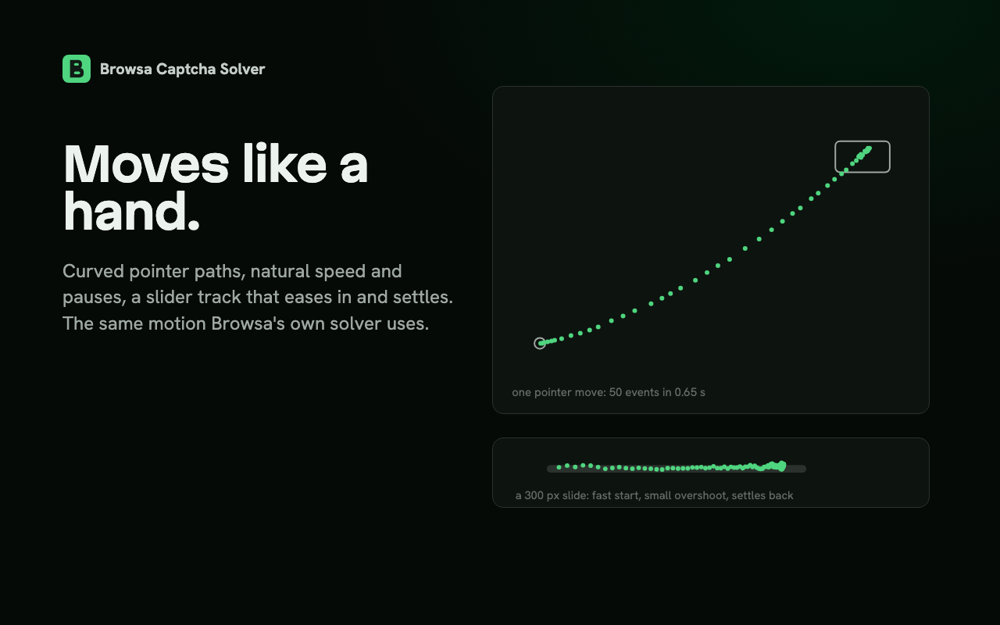

# Browsa Captcha Solver

A browser extension that solves the captcha in front of you with human-like input, using your Browsa API key.

[](https://github.com/browsa-io/captcha-solver/actions/workflows/ci.yml)
[](LICENSE)

This repository is the extension's full source (Manifest V3, Chrome and Firefox from one codebase). The solving
service it calls, Browsa's captcha API, is not part of it.

## Install

- **Chrome** (also Brave, Edge and Opera):
  [Chrome Web Store](https://chromewebstore.google.com/detail/browsa-captcha-solver/plmcdhefocmbmnoccgoghbnidepemhdk)
- **Firefox** (140 or later): pending Mozilla review. It will be at
  [addons.mozilla.org/firefox/addon/browsa-captcha-solver](https://addons.mozilla.org/firefox/addon/browsa-captcha-solver/)
  once approved. Until then you can [build it from source](#build-from-source).

The stores may still serve an earlier version than this source; `package.json` has the version built here.

## Get a key

1. Sign up at [app.browsa.io/signup](https://app.browsa.io/signup). A new account gets 25 free solves to try it.
2. In the dashboard, open **API keys** and create a key.
3. Click the extension's icon, paste the key, **Save**.

Each answer the service gives uses Browsa credits (a picture puzzle can take several answers); an answer it cannot
give is free. The panel shows what each captcha was charged and what is left, and one click on "That was wrong"
reports the last answer of a solve a site refused (Browsa decides about refunds).

## Settings

The panel has the key, on/off, Auto or Manual, Solve, a switch per type, and this site's switches. **Options** has
the rest: for every type "Solve" and "By itself" separately, extra tries after a failed solve and the wait before
each, where the Solve button shows on the page, a skip list or "only the sites below", the sites where picture text
is solved without asking, Trusted input, the server, and export and import of the settings (your key stays out of
the file unless you tick it).

A picture captcha the extension does not recognise: right-click the picture, **Browsa Solver: this picture is a
captcha**, then right-click its field, **the answer goes in this field**. It is remembered for that site.

## What it solves today

A type is on only after at least 15 attempts through the extension with at least 9 in 10 answers accepted by the
provider's or the site's own server (Chrome; Firefox gets a 5-attempt check per type on top). Below that bar a type
ships switched off (Options, "Not ready yet") with its number here.

### New in 0.3.0 (measured 22 Nov 2026, store package, live service)

| Type | Chrome: accepted | median | credits per answer | Firefox (5 attempts) | On in |
|---|---|---|---|---|---|
| GeeTest v4 IconCrush | 16 of 16 | 14.6 s | 0.008 | not shown in a driven Firefox | Chrome |
| GeeTest v4 gobang | 16 of 16 | 15.2 s | 0.008 | not shown in a driven Firefox | Chrome |
| GeeTest v4 nine photos | 16 of 16 | 18.6 s | 0.01 | - | Chrome |
| GeeTest v4 matching shape | 16 of 16 | 17.1 s | 0.01 | - | Chrome |
| Tencent slide | 16 of 16 | 24.2 s | 0.008 | the widget does not open in a driven Firefox | Chrome |
| Tencent click in order | 16 of 16 | 33.9 s | 0.012 | the widget does not open in a driven Firefox | Chrome |
| NetEase Yidun slide | 15 of 15 | 12.4 s | 0.008 | 5 of 5 | Chrome and Firefox |
| NetEase Yidun swap two tiles | 14 of 15 | 20 s | 0.011 | 5 of 5 | Chrome and Firefox |
| NetEase Yidun icons in order | 15 of 15 | 20 s | 0.015 | 5 of 5 | Chrome and Firefox |
| Dingxiang rotate | 15 of 16 | 30.9 s | 0.008 | 5 of 5 | Chrome and Firefox |
| MTCaptcha | 15 of 15 | 12.5 s | 0.011 | 5 of 5 | Chrome and Firefox |
| Cutcaptcha jigsaw | 14 of 15 | - | 0.008 | not available (needs Trusted input) | Chrome, with Trusted input |

Each was also checked in a windowed Chrome (4 to 6 attempts each, all passed after one GeeTest gobang fix). A final
pass on the finished build, one attempt per listed type, was 16 of 17 (the miss: reCAPTCHA v2, where Google gave this
connection long picture rounds).

### From 0.2.0 (measured 21 and 22 Nov 2026)

| Type | Chrome: accepted | median | Firefox: accepted | median | On in |
|---|---|---|---|---|---|
| reCAPTCHA v2 (checkbox) | 31 of 33 | 14.5 s | 11 of 13 (driven Firefox) | 56.6 s | Chrome |
| GeeTest v3 slide | 15 of 15 | 12 s | 15 of 15 | 12.2 s | Chrome and Firefox |
| GeeTest v4 slide | 15 of 15 | 16.5 s | 15 of 15 | 16.6 s | Chrome and Firefox |
| Image text | 14 of 15 | 9.4 s | 15 of 15 | 9.4 s | Chrome and Firefox |
| AWS WAF captcha | 26 of 26 | 16 s | no puzzle shown in 15 visits | - | Chrome |
| ALTCHA | 30 of 30 | 4.3 s | 15 of 15 | 4.6 s | Chrome and Firefox (free) |

**A pass counts only when the provider's or the site's own server accepts the answer** (for example Google's demo
saying "Verification Success", a demo page whose server validates the GeeTest or Yidun result, ALTCHA's proof checked
on the server). Ticking a box or dragging a slider is not counted. Measured on a home connection with a fresh profile
per attempt, which is a friendly case; your results depend on your connection and on each site's settings.

### Off in 0.3.0, with their numbers

- **hCaptcha**: 14 of 15 in a headless Chrome through the live service, but worse in a normal window (4 of 5 in one
  setup, 0 of 3 in another): hCaptcha shows a window mostly scene puzzles that the service does not answer. Off until
  it passes in a normal window.
- **reCAPTCHA audio challenge** (a fallback after picture rounds): 12 of 12 answers accepted, but Google showed a
  challenge in only 12 of 27 visits, so 15 attempts were not reached. Off.
- **GeeTest v4 icons**: 14 of 16, under 9 in 10. Off.
- **CyberSiARA**: 14 of 14 accepted, but the letters appeared in only 14 of 30 visits. Off.
- **Press & hold**: the check did not appear in 6 visits. Off.
- **Cloudflare Turnstile and Cloudflare's check page**: in a person's own Chrome they pass by themselves (14 of 15
  visits), so there is nothing for the extension to do. Off.
- **reCAPTCHA v3**: a score only, nothing to solve on the page.
- **Firefox**: reCAPTCHA, AWS WAF, the other GeeTest v4 puzzles and Tencent are off for a new install (see the tables);
  Trusted input does not exist in Firefox, so Cutcaptcha and Press & hold are Chrome only.

## How it works



- **A content script in every frame.** It runs in each page and frame (`all_frames`), finds a supported captcha,
  and starts the one watcher that frame needs. On pages without a supported captcha it does nothing.
- **Provider checks before anything is spent.** reCAPTCHA, hCaptcha and DataDome are solved automatically only
  when the widget's frame comes from the provider's own address. GeeTest and AWS WAF are solved automatically only
  when the page loaded the provider's own scripts. Class names alone never count.
- **Human-like input.** Pointer paths follow a curved, minimum-jerk track with Fitts's-law timing, small tremor and
  overshoot. Slider drags start fast and settle. Typed answers go key by key with natural gaps
  ([`src/lib/human.ts`](src/lib/human.ts)). By default these are DOM pointer, mouse and key events in the captcha's
  own frame. With **Trusted input** (Chrome only, off by default), the same gestures go through Chrome's debugger
  interface as real input, and Chrome shows a bar while it is attached.
- **No remote code.** Everything that runs is in the package. The API returns only answers: tile numbers, text,
  or a slide distance.

### What is sent, and when

This matches [PRIVACY.md](PRIVACY.md), which is the policy.

The extension talks to one service, Browsa's captcha API (`https://captcha.browsa.io` unless you change the server
in Options), and only in these cases:

- **Solving a captcha**, after a solve was allowed to start:
  - reCAPTCHA, hCaptcha and DataDome: automatically, when the widget's own frame comes from the provider's address
    (google.com / recaptcha.net, hcaptcha.com, captcha-delivery.com).
  - GeeTest and AWS WAF: automatically, when the page loaded the provider's own scripts (geetest.com, awswaf.com).
  - Picture-text captchas: automatically only on sites where you answered "Solve" to the question the extension
    asks the first time, or where you marked the picture yourself. On any other site, only when you press Solve.
  - Anything, when you press Solve (the panel's button, the button on the page, or Alt+Shift+S).
  - At most 3 automatic solves per page load and 10 per site per hour. After an answer was typed, the next picture
    on that page waits 30 s. A picture already solved is never sent again.
- **Checking your key**, when you open the panel, when you change the key and after a paid solve: your key only.
- **Reporting a wrong answer**, only when you press "That was wrong": your key and that answer's id.

`test/e2e` checks this in real browsers: the browser's only way out is a recording proxy, and the run fails if an
install, a solve and a report reach any host other than the page, the API and the welcome page.

A solve sends the captcha's own picture or pictures and its question, the host name of the site (for example
`example.com`, never the full address), and your API key. For hCaptcha, and for any captcha whose picture a page
script cannot read, the picture is a crop of the visible tab limited to the captcha. The rest of the screenshot
never leaves the browser.

It never sends cookies, the page's HTML or text, form contents, passwords, your browsing history, or anything from
pages without a supported captcha. ALTCHA, Turnstile, Cloudflare's check page and Press & hold are handled in the
page itself, and nothing is sent for them.

Browsa does not store captcha pictures. A solve's answer is deleted after 10 minutes. What is kept, on the
server and in your browser, is listed in [PRIVACY.md](PRIVACY.md#what-is-kept).

It also fetches GeeTest's own puzzle pictures from GeeTest's servers (the same files the page already loaded), and
on install opens `https://browsa.io/extension` in a new tab.


## Permissions

| Permission | Why |
|---|---|
| `storage` | Settings, your key and its last check, the sites you allowed, skip or list, the pictures you marked, and the last 50 solves, on your device. Per-session counters and recently solved answers go in session storage, cleared when the browser closes. |
| `contextMenus` | The two right-click entries: "this picture is a captcha" and "the answer goes in this field". |
| Host access `<all_urls>` | Captchas appear on any site and inside the provider's own frames, so the content script must run in those frames, and the sites cannot be listed in advance. The background uses the access to send the captcha to the API, to fetch GeeTest's pictures, and to crop a captcha from the visible tab when a page script cannot read its picture. You can narrow it yourself: Options has a skip list and "only the sites below", and the browser's own site-access setting works too. |
| `debugger` (optional, Chrome) | Requested only when you switch on Trusted input. Sends pointer and key events as real input. Nothing is read through it. |
| `webNavigation` (optional, Chrome) | Requested with Trusted input. Finds where a captcha's frame sits on the page so those events land in the right place. |
| Firefox data collection | Declared for Firefox's install prompt: `authenticationInfo` (your API key), `websiteContent` (the captcha's picture and question) and `browsingActivity` (the host name of the site a captcha is solved on). |

The keyboard shortcut Alt+Shift+S presses Solve.

## Build from source

You need Node.js 22.18 or later (the tests import TypeScript directly) and, for packaging, `zip` and `unzip`.

```bash
git clone https://github.com/browsa-io/captcha-solver.git
cd captcha-solver
npm ci
npm run typecheck
npm test                  # unit tests, no browser
npm run build             # dist/chrome
npm run build:firefox     # dist/firefox
npm run e2e               # the built package in Chrome for Testing (npx playwright-core install chromium)
npm run e2e:firefox       # the same in Firefox through geckodriver (FIREFOX=<binary> picks the browser)
```

The end-to-end suite runs the built package in a fresh browser profile on local fixture pages, against a local
stand-in for the API. It needs no key and reaches nothing on the internet.

Load the build:

- **Chrome**: open `chrome://extensions`, switch on Developer mode, click **Load unpacked**, pick `dist/chrome`.
- **Firefox**: open `about:debugging#/runtime/this-firefox`, click **Load Temporary Add-on**, pick
  `dist/firefox/manifest.json`.

`node scripts/build.mjs --api=https://...` changes the API address compiled in as the default. Options can also
change it.

### Reproducible build

The same source builds the same files. To check a published package against this repository:

```bash
git checkout <commit>         # the commit of the version the store serves (its package.json "version")
npm ci
npm run package               # dist/browsa-captcha-solver-<version>.zip, its sha256, every file's sha256
npm run package:firefox       # dist/browsa-captcha-solver-firefox-<version>.zip, the same

# the package the Chrome Web Store serves
curl -L -o store.crx 'https://clients2.google.com/service/update2/crx?response=redirect&prodversion=131.0&acceptformat=crx2,crx3&x=id%3Dplmcdhefocmbmnoccgoghbnidepemhdk%26uc'
node scripts/hashes.mjs dist/chrome --against=store.crx
```

Compare files, not zip files. A zip also stores file times and order, so the zip's own sha256 only matches a zip
made the same way. `npm run package` fixes both, so its zip is identical on every machine with Info-ZIP's `zip`.
The stores add their own files: a `.crx` carries `_metadata/` and an `update_url` line at the top of
`manifest.json`, and a signed `.xpi` carries `META-INF/`. `scripts/hashes.mjs` leaves those out and says so.

The tree hash, one sha256 over the per-file list, is what `find . -type f | LC_ALL=C sort | xargs sha256sum | sha256sum`
prints in the build folder. Every CI run rebuilds both packages, prints these hashes, uploads the zips as a build
artifact, and compares with the Chrome Web Store package when the store serves the same version.

## Automation (Puppeteer, Playwright, Selenium)

The automation build is an unpacked build that takes its settings from a file, so a fresh profile needs no clicks.
Keep the key in the environment, not in a file:

```bash
cp automation.example.json automation.json    # git-ignored; edit the settings, leave apiKey as is
BROWSA_API_KEY=agt_live_... npm run build:automation                       # dist/automation
BROWSA_API_KEY=agt_live_... npm run build:automation -- --target=firefox   # dist/automation-firefox
```

The key is written only into `dist/automation/automation.json`, which is git-ignored. The settings are applied on
install and on every browser start. Set `"trustedInput": true` to use Trusted input. The automation build has the
`debugger` permission without a prompt. Wait about two seconds after the browser starts before changing settings
yourself, so the install step does not overwrite them.

Branded Google Chrome 137 and later ignores `--load-extension`. Use Chrome for Testing
(`npx @puppeteer/browsers install chrome@stable`, or the browser Playwright installs). Some sites refuse a browser
whose user agent says `HeadlessChrome` before any captcha appears. Set a normal user agent if that happens.

```js
import path from 'node:path';
const ext = path.resolve('dist/automation');

// Playwright
import { chromium } from 'playwright';
const ctx = await chromium.launchPersistentContext('/tmp/profile', {
  headless: false,
  args: ['--headless=new', `--disable-extensions-except=${ext}`, `--load-extension=${ext}`],
});

// Puppeteer
import puppeteer from 'puppeteer';
const browser = await puppeteer.launch({
  headless: false,
  executablePath: chromeForTesting,          // path to Chrome for Testing
  args: ['--headless=new', `--disable-extensions-except=${ext}`, `--load-extension=${ext}`],
});
```

```python
# Selenium
import os
from selenium import webdriver
opts = webdriver.ChromeOptions()
opts.binary_location = CHROME_FOR_TESTING   # path to Chrome for Testing
ext = os.path.abspath("dist/automation")
opts.add_argument("--headless=new")
opts.add_argument(f"--load-extension={ext}")
driver = webdriver.Chrome(options=opts)
```

### Knowing the result

The automation build writes each outcome on the page's top document as `<html data-browsa-captcha="...">` and fires
a `browsa-captcha` event on `document`:

```js
// solving:<type> | solved:<type> | typed:text | failed:<type>:<reason> | skipped:<type>:<reason> | paused:... | unsupported:...
await page.waitForFunction(() => /^(solved|typed|failed|skipped|unsupported)/.test(
  document.documentElement.dataset.browsaCaptcha || ''));
const state = await page.evaluate(() => document.documentElement.dataset.browsaCaptcha);   // e.g. "solved:recaptcha"
// or: document.addEventListener('browsa-captcha', (e) => e.detail /* { state, kind, reason } */)
```

Errors arrive the same way, for example `skipped:text:no_key`, `failed:text:error_key_denied_access` or
`failed:geetest:error_zero_balance`. The store build never writes this signal, because it would tell sites that
the extension is installed.

## Project layout

| Path | What it is |
|---|---|
| `src/content/` | The content script: one module per captcha type, the in-page notice, and `main.ts`, which starts them |
| `src/lib/` | Settings (`config.ts`), provider checks (`origin.ts`), what may start a solve (`guard.ts`), motion (`human.ts`), input (`input.ts`), messages (`reasons.ts`, `i18n.ts`) |
| `src/background.ts` | The only network requests: API calls, GeeTest pictures, the tab-capture fallback, the solve log |
| `src/popup/`, `src/options/` | The panel and the Options page |
| `src/_locales/en/messages.json` | Every text a person reads (English; another language is one more file) |
| `scripts/` | `build.mjs`, `package.mjs` (store zips), `hashes.mjs` (file hashes and comparison) |
| `test/` | Unit tests (`npm test`) with fixture pages in `test/fixtures`; `test/e2e/` runs the built package in Chrome and Firefox. No keys or network needed |

## Contributing and security

See [CONTRIBUTING.md](CONTRIBUTING.md). Report security issues privately to support@browsa.io
([SECURITY.md](SECURITY.md)). Changes per version: [CHANGELOG.md](CHANGELOG.md).

## License

[MIT](LICENSE), Copyright (c) 2026 Browsa Technologies LLC. The license covers this code. It does not grant use of
the Browsa name or logo, or access to the Browsa API, which needs an account.

`static/fonts/hanken-grotesk.woff2` is Hanken Grotesk, Copyright 2021 The Hanken Grotesk Project Authors, under the
SIL Open Font License 1.1 (license text in [`static/fonts/OFL.txt`](static/fonts/OFL.txt)).

## Links

- Extension page: [browsa.io/extension](https://browsa.io/extension)
- Privacy policy: [browsa.io/extension/privacy](https://browsa.io/extension/privacy)
- Support: support@browsa.io
